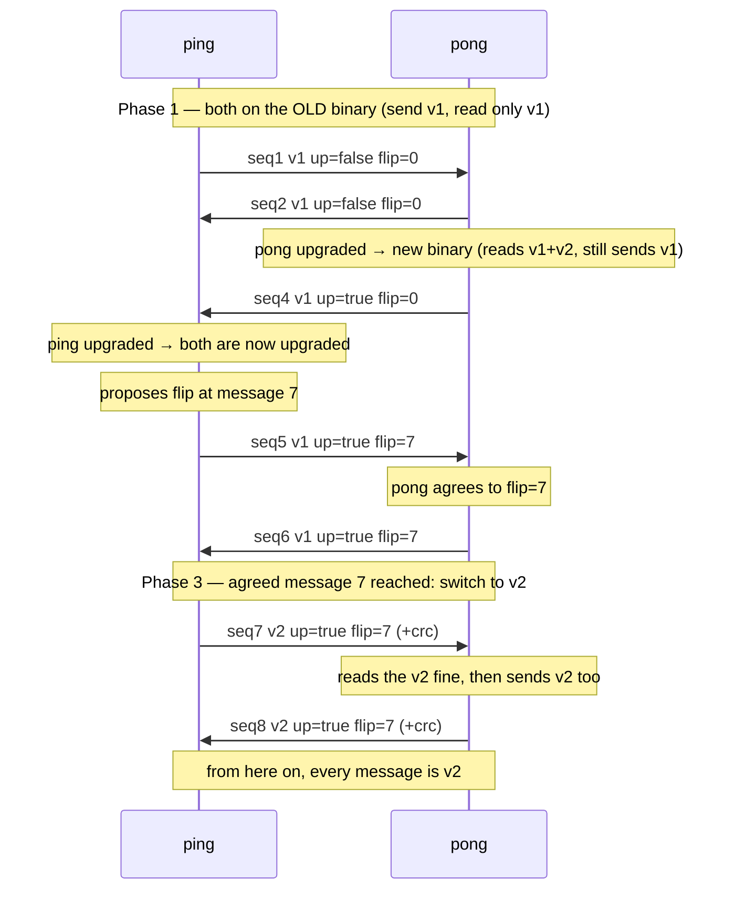

# pingpong — a live rolling protocol upgrade

Two peers, **ping** and **pong**, are two **real processes** that take turns exchanging
messages over TCP. The message wire format is changing from **v1** to **v2** (v2 adds a
checksum). This demo rolls that change across the two peers with gatekit — with **no
downtime** and **no split-brain** — and does the switch **mid-conversation**. It is the
protocol-coexistence companion to the [kv capstone](../kv/) (the on-disk data migration)
and the live form of the course's
[worked rollout](../../../docs/appendix/worked-example.md).

## Run it (two terminals)

Start pong first; it listens. Then start ping in a second terminal; it connects.

```bash
cd examples/go
go run ./pingpong pong      # terminal 1 — listens, plays "pong"
go run ./pingpong ping      # terminal 2 — connects, plays "ping"
```

Or run both in one process (also what the test drives):

```bash
go run ./pingpong demo
```

## The three phases

A real rolling upgrade does not happen all at once. gatekit separates **deploying** the
new code from **activating** the new behavior, which lets the upgrade move through three
phases:

1. **Old binary (v1 only).** Both peers start on the old binary: they send v1 and can
   *only read* v1. Nobody may send v2 yet — the other side could not parse it.
2. **Rolling deploy (v1 + v2 capable).** Each peer is upgraded to the new binary **at a
   different time**. The new binary **reads both** v1 and v2, but it keeps **sending v1**
   (the feature is dormant). This mixed-version window is safe precisely because the
   upgraded peer still speaks the old format.
3. **The negotiated flip.** Once both peers are upgraded, one proposes a **flip message
   number** — carried in a `flip=` field on the wire, in an ordinary **v1** message. Both
   adopt it, and when the conversation reaches that number they switch to **sending v2**.



## Why they don't flip at the same instant — and why that's fine

Two independent processes share no clock, so they can't switch at the same *instant*.
They don't need to. The rule is **decode both, send one**: a new binary always
*understands* v1 and v2, but only *sends* v2 after the flip. So when ping sends the first
v2 message, pong — already upgraded — reads it even though pong itself sent v1 a moment
ago, then sends v2 from its next turn. The one-message skew is harmless because both can
already read either format. What they agree on is not an instant but a **point in the
conversation** (the `flip=` message number), negotiated in-band.

This is the Kafka `inter.broker.protocol.version` pattern: deploy new binaries that
understand both protocols, keep speaking the old one, then raise the agreed version once
everyone is ready.

## Sample output (`demo`)

```
>> seq= 1  v1|from=ping|seq=1|up=false|flip=0
...
-- upgraded to the new binary at message 4 (now reads v1 AND v2; still sending v1)
-- upgraded to the new binary at message 5 (now reads v1 AND v2; still sending v1)
-- both peers upgraded: proposing flip to v2 at message 7
-- agreed to flip to v2 at message 7
>> seq= 6  v1|from=pong|seq=6|up=true|flip=7
-- reached the agreed message 7: flipping to v2 (sending v2 now)
>> seq= 7  v2|from=ping|seq=7|up=true|flip=7|crc=78911897
<< seq= 7  v2|from=ping|seq=7|up=true|flip=7|crc=78911897  (we read v2 though we still send v1 — decode both, send one)
...
-- done after 12 messages; no message ever failed to decode
```

`-upgrade-ping`, `-upgrade-pong` set when each peer is upgraded; `-lead` sets how far
ahead the flip is proposed; `-rounds` the message count. Set `-upgrade-pong` beyond
`-rounds` and watch the flip never happen — the peers hold on v1, because it is never safe
to send v2 to a peer that cannot read it.

## What to watch

- **Dormant after upgrade.** Once a peer is upgraded it *can* speak v2, but it keeps
  sending v1 until the agreed flip — staying compatible with a peer that has not upgraded
  yet. That is the mixed-binary **coexistence** window.
- **The flip point is negotiated on the wire.** The `flip=` number rides in v1 messages,
  so both peers agree on *which message* starts v2 — no shared config, no shared clock.
- **Decode both, send one.** A new binary always *understands* v1 and v2, but only *sends*
  v2 after the flip. An old binary only understands v1 — which is why an upgraded peer must
  not send v2 until it has seen its partner upgrade (`up=true`).

## Files

| File | What it holds |
|------|---------------|
| `feature.go` | the `MessageFormatV2` feature, the registry, and each peer's activation version |
| `message.go` | the `Msg` payload and the v1 / v2 wire encoders + decoder (the checksum) |
| `peer.go` | a peer: its binary version and gate, the rollout phases, and encode/decode |
| `transport.go` | the TCP listen (pong) and dial (ping) sides |
| `demo.go` | runs both peers in one process over an in-memory pipe |
| `main.go` | the `ping` / `pong` / `demo` subcommands and flags |
| `peer_test.go` | drives the demo and verifies the invariants (`go test ./pingpong`) |

The two peers are real processes over a real socket; `demo` runs the same `runPeer` code
over an in-memory pipe so it is deterministic and testable. The "old binary" is modeled by
a flag on the peer rather than a second build, so the whole rollout fits in one example.
